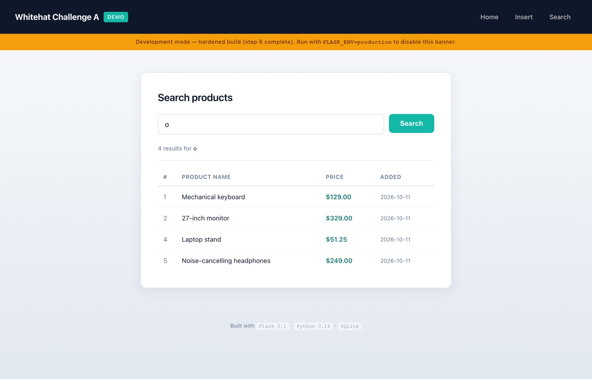
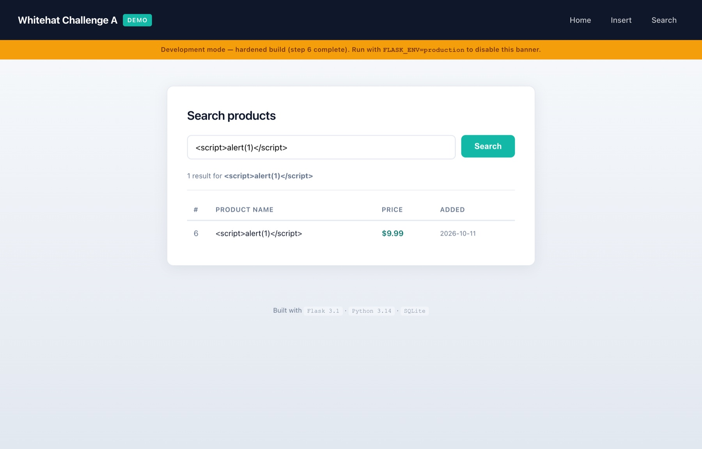
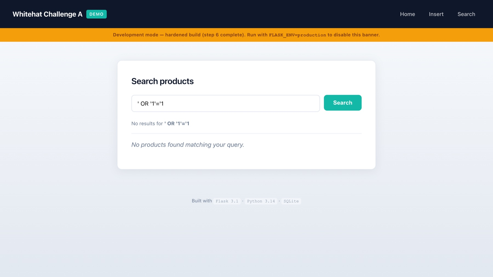
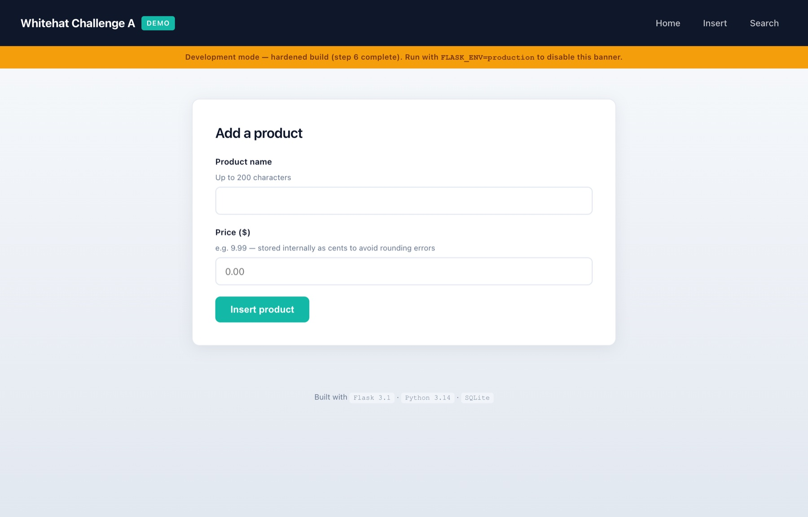

<p align="center">
  
</p>

<h1 align="center">Whitehat Challenge A</h1>

<p align="center">
  <b>A deliberately vulnerable Flask app, exploited with real payloads, then hardened — and cross-tested to prove every protection holds.</b><br>
  <sub>Technical take-home for White-Hat (EPAM) · Flask 3.1 · Python 3.14 · SQLite</sub>
</p>

<p align="center">
  
  
  
  
  
</p>

---

Secure product management web application — insert and search products via a
Flask + SQLite backend.

Built as a technical take-home for **White-Hat (EPAM)** to demonstrate a
secure-by-design approach: vulnerabilities are first deliberately introduced and
exploited, then fixed with isolated commits, then cross-tested to prove the
protections work.

## The two attacks, after the fix

<p align="center">
  
  <br><sub><code>&lt;script&gt;alert(1)&lt;/script&gt;</code> stored in the database and rendered back — as <b>text</b>. Jinja2 auto-escape turns it into <code>&amp;lt;script&amp;gt;</code>, and the CSP would refuse to run it even if it got through.</sub>
</p>

<p align="center">
  
  <br><sub><code>' OR '1'='1</code> in the search box. With a concatenated query this returns every row; with a parameterized one it is just a string that matches nothing.</sub>
</p>

<p align="center">
  
  <br><sub>Every POST carries a signed CSRF token. A forged cross-origin request cannot read it and is rejected with HTTP 400 before reaching any application logic.</sub>
</p>

---

## Stack

| Component | Version | Role |
|---|---|---|
| Python | 3.14.4 | Runtime (Homebrew, not macOS system EOL Python 3.9) |
| Flask | 3.1.3 | Web framework |
| Flask-WTF | 1.2.2 | CSRF protection |
| SQLite | stdlib `sqlite3` | Database (single file, zero external deps) |
| Jinja2 | 3.1.6 | Templating with auto-escape ON |
| Werkzeug | 3.1.8 | WSGI dev server |

---

## Quick start

```bash
# 1. Clone
git clone <repo-url>
cd whitehat-challenge-a

# 2. Create and activate virtual environment
python3.14 -m venv venv
source venv/bin/activate          # Windows: venv\Scripts\activate

# 3. Install dependencies
pip install -r requirements.txt

# 4. Initialize the database
python init_db.py

# 5. Run the development server
python app.py
```

Open **http://127.0.0.1:5001** in your browser.

> **Note:** port 5001 is used intentionally — port 5000 is occupied by macOS
> AirPlay Receiver since Monterey.

---

## Features

| Route | Method | Description |
|---|---|---|
| `/` | GET | Home page |
| `/insert` | GET, POST | Add a product (name + price) |
| `/search` | GET | Search products by name (substring) |

**Price** is stored as an integer (cents) to avoid IEEE 754 floating-point
rounding errors. Display converts back to dollars (`price / 100`).

---

## Security architecture

This app was built with a **vulnerable-first, then fixed** methodology.
Four vulnerabilities were deliberately introduced in steps 4–5, exploited
with real payloads, then fixed in step 6 with separate atomic commits.
Step 7 cross-tests replayed every attack to confirm each protection holds.

### Protections implemented

#### 1. SQL Injection — parameterized queries

All database queries use the `sqlite3` parameterized form. The SQL string
and the user-supplied values are never concatenated.

```python
# VULNERABLE (step 4 — now removed):
conn.executescript(f"INSERT INTO products (name, price) VALUES ('{name}', {price})")

# FIXED (step 6, commit 4efd292):
conn.execute("INSERT INTO products (name, price) VALUES (?, ?)", (name, price))
conn.execute("SELECT ... WHERE name LIKE ?", (f"%{q}%",))
```

**Verified:** payload `Hack', 0); DROP TABLE products; --` is stored as
literal text. Table remains intact.

#### 2. Stored XSS — Jinja2 auto-escape

The `| safe` filter has been removed from all templates. Jinja2 auto-escape
(enabled by default in `.html` templates) converts `<` → `&lt;`, `>` → `&gt;`.
Server-side whitelist validation (`validate_name`, `validate_price`) adds a
second layer before data reaches the database.

```html
<!-- VULNERABLE (step 5 — now removed): -->
<td>{{ row[1] | safe }}</td>

<!-- FIXED (step 6, commit 0ad0694): -->
<td>{{ row[1] }}</td>
```

**Verified:** payload `` renders as
`&lt;img src=x onerror=alert(1)&gt;` — inert text, no JS execution.

#### 3. CSRF — Flask-WTF token

Every POST form includes a signed CSRF token generated by Flask-WTF. A
forged cross-origin request cannot read this token (same-origin policy) and
is rejected with HTTP 400 before reaching any application logic.

```python
# app.py
csrf = CSRFProtect(app)
```

```html
<!-- insert.html -->
<input type="hidden" name="csrf_token" value="{{ csrf_token() }}">
```

**Verified:** `curl -X POST /insert -d "name=x&price=1"` → HTTP 400.

#### 4. Server header — information disclosure

Werkzeug injects `Server: Werkzeug/3.1.8 Python/3.14.4` at the TCP connection
level. This is overridden at two layers:

```python
# Connection-level (Werkzeug):
WSGIRequestHandler.server_version = "Web Server"
WSGIRequestHandler.version_string = lambda self: "Web Server"

# Response-level (Flask after_request):
response.headers["Server"] = "Web Server"
```

**Verified:** `curl -i / | grep -i server` → `Server: Web Server` (both headers).

#### 5. Clickjacking — X-Frame-Options

`X-Frame-Options: DENY` is set on every response via `@after_request`
middleware. This prevents the application from being embedded in a `<iframe>`
on a malicious page.

#### 6. Content Security Policy

```
Content-Security-Policy: default-src 'self'; style-src 'self'; script-src 'none'; object-src 'none';
```

No inline scripts, no external scripts, no plugins. This is a defense-in-depth
backstop: even if an XSS payload survived the Jinja2 layer, the browser would
refuse to execute it.

#### 7. Generic error pages

`@app.errorhandler(400/404/500)` returns a plain `error.html` template.
`sqlite3.Error` details are caught and logged server-side only. The client
receives only a generic string such as `"An error occurred. Please try again."`.
No stack traces, no schema details, no framework internals are exposed.

#### 8. Debug mode controlled by environment

```python
is_production = os.environ.get("FLASK_ENV") == "production"
app.run(host="127.0.0.1", port=5001, debug=not is_production)
```

Development default: `debug=True` (auto-reload, bound to loopback only).
Production: set `FLASK_ENV=production` — disables the Werkzeug interactive
debugger (which allows arbitrary Python execution via browser console if
exposed to the network).

### Defense in depth — DB-level constraints

Beyond the reference document requirements, the schema adds `CHECK` constraints
as a final data-integrity backstop:

```sql
name  TEXT NOT NULL CHECK (length(name) > 0 AND length(name) <= 200)
price INTEGER NOT NULL CHECK (price >= 0)
```

If Flask validation is bypassed (direct DB access, future bug), the database
itself rejects invalid rows with `IntegrityError`.

---

## Project methodology

```
Step 1  Setup environment (venv, Flask, git)
Step 2  SQLite schema + DB init script
Step 3  Minimal Flask app (routes, templates, CSS)
Step 4  Vulnerable insert page (SQLi, XSS, CSRF, info disclosure — demonstrated)
Step 5  Vulnerable search page (UNION SELECT, OR 1=1, stored XSS — demonstrated)
Step 6  Security hardening (4 atomic commits, one per vulnerability class)
Step 7  Cross-tests — every attack replayed, all blocked  → cross-tests.md
Step 8  This README
```

Git log shows each vulnerability fixed in a dedicated commit:

| Commit | Fix |
|---|---|
| `4efd292` | `security(sqli)` — parameterized queries |
| `0ad0694` | `security(xss)` — remove `\| safe`, add whitelist validation |
| `067ca33` | `security(csrf)` — Flask-WTF CSRFProtect |
| `39988d7` | `security(headers)` — Server header, CSP, error handlers, debug env |

---

## Audit trail

| Document | Purpose |
|---|---|
| [`security-audit.md`](security-audit.md) | Maps every requirement of the White-Hat secure development reference to the codebase. 14/15 items compliant. |
| [`cross-tests.md`](cross-tests.md) | Before/after test log — 8 attack replays, all blocked on the hardened build. |
| [`interview-prep.md`](interview-prep.md) | Q&A study guide (French) covering all design and security decisions. |

---

## Production deployment notes

This repository runs on Flask's built-in development server, which is **not
suitable for production**. A production deployment would require:

1. **WSGI server:** replace the dev server with Gunicorn or uWSGI.
   ```bash
   gunicorn -w 4 -b 127.0.0.1:5001 "app:app"
   ```

2. **TLS termination:** place nginx or Cloudflare in front. Never expose
   Flask directly on port 443.
   ```nginx
   server {
       listen 443 ssl;
       server_tokens off;          # hides nginx version too
       location / {
           proxy_pass http://127.0.0.1:5001;
           proxy_set_header Host $host;
       }
   }
   ```

3. **Environment variables:** replace the `SECRET_KEY` fallback with a
   cryptographically random value injected at deploy time (never hardcode).
   ```bash
   export SECRET_KEY=$(python -c "import secrets; print(secrets.token_hex(32))")
   export FLASK_ENV=production
   ```

4. **Database:** for multi-write concurrent workloads, replace SQLite with
   PostgreSQL or MySQL and use a dedicated DB user with `GRANT INSERT, SELECT`
   only — never `DROP`, `ALTER`.

5. **Rate limiting:** add Flask-Limiter to mitigate volumetric insert/search abuse.

6. **Structured logging:** route logs to a SIEM (Elastic, Splunk) for real-time
   attack detection.
